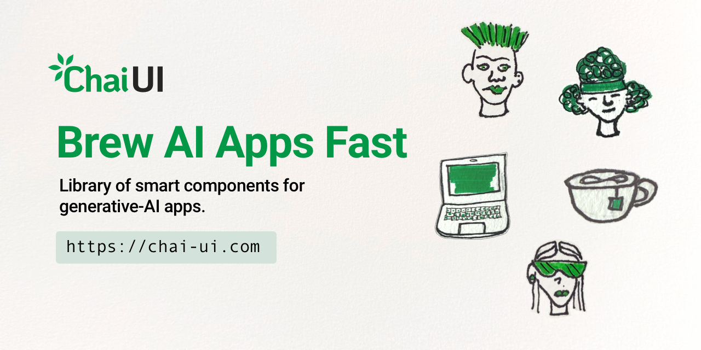
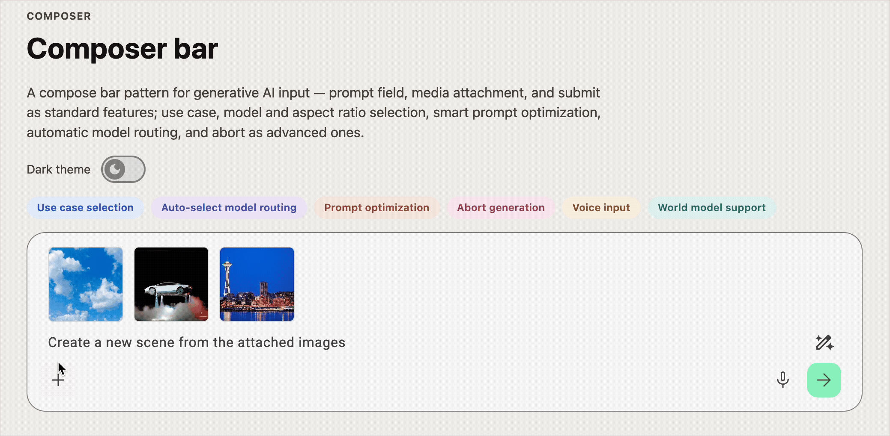

<p align="center">
  <a href="https://chai-ui.com"></a>
</p>

<p align="center">
  <a href="https://github.com/kazarazat/chai-ui/actions/workflows/ci.yml"></a>
  <a href="https://codecov.io/gh/kazarazat/chai-ui"></a>
  <a href="https://www.npmjs.com/package/@chai-ui/react"></a>
  <a href="./LICENSE"></a>
  <a href="#install"></a>
  <a href="#install"></a>
  <a href="#install"></a>
  <a href="#accessibility"></a>
</p>

<p align="center">
  <a href="https://chai-ui.com/docs"></a>
</p>

**A design system for AI model interactions.** Every component comes with
its use case instructions built in, is built on Material Design 3 and
styled by your design tokens, and runs on Fal.ai, OpenRouter, Vercel AI
Gateway or your own engine. For React, Vue and Svelte.

Docs and live examples: **[chai-ui.com/docs](https://chai-ui.com/docs)**

**Building with an AI agent?** Point it at [DESIGN.md](packages/shared/DESIGN.md)
(it also ships in every component package) and the full reference at
[chai-ui.com/docs/llms.txt](https://chai-ui.com/docs/llms.txt), then ask it
what Chai UI can do. Between them they cover every component, use case and
option.

## Components

| Component | What it does |
|---|---|
| `Composer` | A prompt bar for image, video, audio, text and world models, with attachments, use cases, a pre-filled model menu whose aspect ratios match each model, prompt optimization, auto-select routing, stop and opt-in voice input. |
| `MediaAnalyzer` | Turns a dropped image, video or audio clip into a generation-ready prompt, with the analysis model and prompt length chosen by the user. |
| `ResultCard` | Shows one prompt's results from one or several models in a single card, paging between them, as image, video, audio or streaming text with like, retry, download, share, a details flip and pass or fail quality checks. |
| `EditCard` | Edits an image through regions drawn on it, each with its own instruction, then pages from the original through every edited version. |
| `SidePanel` | A panel on the left or right of your page holding a Composer and its answers, for quick questions about the page or anything else, with opt-in page context, prompt tips, and push or overlay layouts. |

## Install

```sh
pnpm add @chai-ui/react @chai-ui/core @chai-ui/tokens   # React 18.3 or 19
pnpm add @chai-ui/vue @chai-ui/core @chai-ui/tokens     # Vue 3.5 or later, Nuxt included
pnpm add @chai-ui/svelte @chai-ui/core @chai-ui/tokens  # Svelte 5, SvelteKit included
```

All three packages have the same components and behavior, and run the same tests.

## Quick start

```tsx
import "@chai-ui/tokens/css";
import "@chai-ui/react/style.css";
import { useState } from "react";
import { ChaiProvider, Composer, ResultCard, createFalEngine, useComposer } from "@chai-ui/react";

const engine = createFalEngine();

function App() {
  const [value, setValue] = useState("");
  const { run, submit, cancel } = useComposer({ engine });
  const busy = run?.results.some((r) => r.status === "queued" || r.status === "running") ?? false;

  return (
    <>
      <Composer value={value} onChange={setValue} onSubmit={submit} submitting={busy} onAbort={cancel} />
      {run && <ResultCard results={run.results} prompt={run.request.prompt} onAction={() => {}} />}
    </>
  );
}

export default function Root() {
  return (
    <ChaiProvider>
      <App />
    </ChaiProvider>
  );
}
```

<details>
<summary><strong>The same in Vue</strong></summary>

```vue
<!-- main.ts imports "@chai-ui/tokens/css" and "@chai-ui/vue/style.css";
     ChaiProvider wraps this component, e.g. in App.vue. -->
<script setup lang="ts">
import { computed, ref } from "vue";
import { Composer, ResultCard, createFalEngine, useComposer } from "@chai-ui/vue";

const engine = createFalEngine();
const value = ref("");
const { run, submit, cancel } = useComposer({ engine });
const busy = computed(() => run.value?.results.some((r) => r.status === "queued" || r.status === "running") ?? false);
</script>

<template>
  <Composer v-model="value" :submitting="busy" @submit="submit" @abort="cancel" />
  <ResultCard v-if="run" :results="run.results" :prompt="run.request.prompt" @action="() => {}" />
</template>
```

</details>

<details>
<summary><strong>The same in Svelte</strong></summary>

```svelte
<!-- +layout.svelte imports "@chai-ui/tokens/css" and "@chai-ui/svelte/style.css",
     and wraps the page in ChaiProvider. -->
<script lang="ts">
  import { Composer, ResultCard, createFalEngine, useComposer } from "@chai-ui/svelte";

  const composer = useComposer({ engine: createFalEngine() });
  let value = $state("");
  const busy = $derived(composer.run?.results.some((r) => r.status === "queued" || r.status === "running") ?? false);
</script>

<Composer {value} onChange={(next) => (value = next)} submitting={busy} onSubmit={composer.submit} onAbort={composer.cancel} />
{#if composer.run}
  <ResultCard results={composer.run.results} prompt={composer.run.request.prompt} onAction={() => {}} />
{/if}
```

</details>

To try it before setting up a provider, leave out `engine` and
`ChaiProvider`: everything then runs on built-in mocks, with no network
calls and no keys.

## Your API keys stay on your server

The engines call one route on your server, which adds the key. In Next.js
it's one file:

```ts
// app/api/chai/[...path]/route.ts
import { createChaiHandler } from "@chai-ui/core/server";

export const { GET, POST, PUT } = createChaiHandler();
```

Then set `FAL_KEY`, `OPENROUTER_API_KEY` or `AI_GATEWAY_API_KEY` on your server. React Router
(or Remix), Nuxt, SvelteKit, and API servers behind a Vite app (Express, Hono,
Cloudflare Workers, Bun, Deno), are covered in the [`@chai-ui/core` README](./packages/core/README.md#the-server-route-chai-uicoreserver),
along with `authorize` and `allowedModels` for production.

## Packages

| Package | What it is |
|---|---|
| [`@chai-ui/react`](./packages/react) | The components and hooks, for React |
| [`@chai-ui/vue`](./packages/vue) | The same components and composables, for Vue |
| [`@chai-ui/svelte`](./packages/svelte) | The same components and hooks, for Svelte and SvelteKit |
| [`@chai-ui/core`](./packages/core) | Framework-free data model, engines and the server route |
| [`@chai-ui/tokens`](./packages/tokens) | Design tokens as CSS variables, JS and a Figma token set |

## Accessibility

Chai's components are built to support WCAG 2.2 AA. Every component is
tested in a real browser with axe, against the WCAG 2.0, 2.1 and 2.2 A and
AA rules, and with keyboard and focus checks, in the React, Vue and Svelte
packages. Automated checks can't catch everything, and conformance
belongs to a whole page, so your app still needs its own checks. See
[DESIGN.md](./packages/shared/DESIGN.md#6-accessibility).

## Help and contributing

- Questions and troubleshooting: [SUPPORT.md](./SUPPORT.md)
- Bugs and ideas: [open an issue](https://github.com/kazarazat/chai-ui/issues/new/choose)
- Contributing: [CONTRIBUTING.md](./CONTRIBUTING.md)
- Security: [SECURITY.md](./SECURITY.md)

## License

[MIT](./LICENSE) © kazarazat

Illustrations © 2026 Imani Razat, used with permission. They aren't
covered by the MIT license.
